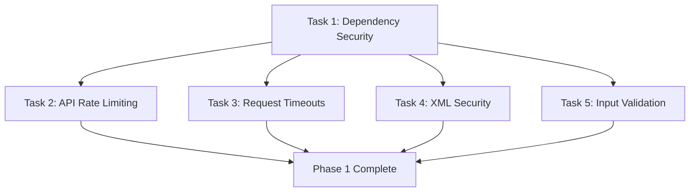

# Implementation Tasks: Security Evaluation Dexter Financial Research Agent

**Tasks ID:** tasks-001
**Related Eval:** eval-001-security-review
**Date:** 2025-11-16
**Priority:** CRITICAL (Phase 1 - 1 week timeline)
**Repository:** https://github.com/virattt/dexter
**Branch:** security/eval-001-security-assessment

## Executive Summary

Based on the security evaluation identifying **13 vulnerabilities** with **CRITICAL** risk level, this document breaks down the Phase 1 critical remediation tasks into actionable subtasks. These tasks address the most severe security issues requiring immediate attention to prevent production deployment risks.

**Phase 1 Timeline:** 1 week (accelerated from 2 weeks due to CRITICAL findings)

## Phase 1 Critical Tasks

### Task 1: Dependency Security Implementation
**Priority:** CRITICAL | **Estimated Time:** 2 days | **Owner:** TBD

#### 1.1 Research and Select Dependency Scanning Tool
- [ ] Evaluate `safety` vs `snyk` options
- [ ] Test integration with existing `pyproject.toml`
- [ ] Review licensing and cost implications
- [ ] **Acceptance Criteria:** Tool selected with integration plan documented

#### 1.2 Install and Configure Dependency Scanning
- [ ] Add scanning tool to `pyproject.toml` dependencies
- [ ] Configure automated vulnerability scanning in CI/CD pipeline
- [ ] Set up vulnerability severity thresholds
- [ ] Create requirements.txt with hash checking for production
- [ ] **Acceptance Criteria:** Automated scanning operational with daily reports

#### 1.3 Implement Vulnerability Response Process
- [ ] Create vulnerability remediation SLA (7 days for critical, 30 days for high)
- [ ] Set up automated vulnerability alerts (email/slack)
- [ ] Document dependency update process
- [ ] Create emergency patch procedure for zero-day vulnerabilities
- [ ] **Acceptance Criteria:** Response process documented and tested

#### 1.4 Initial Vulnerability Scan and Remediation
- [ ] Run comprehensive scan of all 9 dependencies
- [ ] Document current vulnerability status
- [ ] Prioritize and fix any critical/high severity findings
- [ ] Update dependencies to secure versions
- [ ] **Acceptance Criteria:** No critical/high vulnerabilities remain

### Task 2: API Rate Limiting and Cost Controls
**Priority:** CRITICAL | **Estimated Time:** 1.5 days | **Owner:** TBD

#### 2.1 Financial Datasets API Rate Limiting
- [ ] Research Financial Datasets API rate limits and quotas
- [ ] Design rate limiting strategy (requests/second, daily quotas)
- [ ] Implement rate limiting in `src/dexter/tools/finance/api.py`
- [ ] Add retry logic with exponential backoff
- [ ] **Acceptance Criteria:** API calls respect rate limits with proper error handling

#### 2.2 OpenAI API Rate Limiting and Cost Controls
- [ ] Review OpenAI API pricing and rate limits
- [ ] Implement token usage tracking per request
- [ ] Set daily/monthly cost thresholds with alerts
- [ ] Add circuit breaker to prevent cost overruns
- [ ] **Acceptance Criteria:** Cost monitoring active with automatic throttling

#### 2.3 Usage Monitoring and Alerting
- [ ] Create API usage dashboard/metrics
- [ ] Set up alerts for unusual usage patterns
- [ ] Implement logging for API usage analysis
- [ ] Create cost reporting mechanism
- [ ] **Acceptance Criteria:** Real-time monitoring with alert thresholds configured

#### 2.4 Resource Controls and Circuit Breakers
- [ ] Implement API quota management
- [ ] Add circuit breaker pattern for API failures
- [ ] Create graceful degradation for API unavailability
- [ ] Test circuit breaker functionality
- [ ] **Acceptance Criteria:** System gracefully handles API failures and quota exhaustion

### Task 3: Request Timeouts and Resource Management
**Priority:** HIGH | **Estimated Time:** 0.5 day | **Owner:** TBD

#### 3.1 Fix B113: Add Request Timeouts (Bandit Confirmed)
- [ ] Add timeout parameters to `src/dexter/tools/finance/api.py:16`
  - Connection timeout: 30 seconds
  - Read timeout: 60 seconds
- [ ] Add timeout parameters to `src/dexter/tools/search/google.py:21`
  - Connection timeout: 30 seconds
  - Read timeout: 60 seconds
- [ ] Test timeout behavior with network failures
- [ ] **Acceptance Criteria:** All HTTP requests have appropriate timeouts

#### 3.2 Error Handling Improvement
- [ ] Implement proper timeout exception handling
- [ ] Add user-friendly timeout error messages
- [ ] Create retry logic for transient failures
- [ ] Log timeout events for monitoring
- [ ] **Acceptance Criteria:** Timeouts handled gracefully with informative user feedback

### Task 4: XML Security Implementation
**Priority:** HIGH | **Estimated Time:** 0.5 day | **Owner:** TBD

#### 4.1 Fix B405/B314: Replace Insecure XML Parsing (Bandit Confirmed)
- [ ] Install `defusedxml` package dependency
- [ ] Replace `xml.etree.ElementTree` with `defusedxml.ElementTree` in `src/dexter/tools/search/utils.py:8-9`
- [ ] Add `defusedxml.defuse_stdlib()` call for system-wide protection
- [ ] Test XML parsing with security controls
- [ ] **Acceptance Criteria:** XML parsing uses secure defusedxml implementation

#### 4.2 XML Input Validation
- [ ] Add XML size limits to prevent XML bomb attacks
- [ ] Implement XML schema validation if applicable
- [ ] Add error handling for malformed XML
- [ ] Test with various XML attack vectors
- [ ] **Acceptance Criteria:** XML input validation prevents known attack vectors

### Task 5: Enhanced Input Validation Framework
**Priority:** CRITICAL | **Estimated Time:** 1 day | **Owner:** TBD

#### 5.1 User Input Sanitization
- [ ] Design input validation patterns for financial queries
- [ ] Implement length limits for user queries (max 1000 characters)
- [ ] Add character validation and encoding checks
- [ ] Create allowlist for allowed financial query patterns
- [ ] **Acceptance Criteria:** All user inputs validated and sanitized

#### 5.2 Prompt Injection Prevention
- [ ] Implement prompt injection detection patterns
- [ ] Add input filtering for special characters and commands
- [ ] Create safe prompt templating system
- [ ] Test with common prompt injection techniques
- [ ] **Acceptance Criteria:** Prompt injection attempts blocked or neutralized

#### 5.3 Output Encoding and Validation
- [ ] Implement output encoding for user-facing content
- [ ] Add response sanitization framework
- [ ] Create display security controls
- [ ] Test output with various injection attempts
- [ ] **Acceptance Criteria:** All user outputs properly encoded and validated

## Task Dependencies

## Testing Strategy

### Security Testing Requirements
- [ ] Run `bandit` after each fix to confirm resolution
- [ ] Test dependency scanning with known vulnerable packages
- [ ] Verify rate limiting with high-volume requests
- [ ] Test timeout behavior with simulated network failures
- [ ] Validate XML parsing with malicious inputs
- [ ] Test input validation with injection attempts

### Regression Testing
- [ ] Ensure all existing functionality still works
- [ ] Verify performance impact is minimal
- [ ] Test error conditions and recovery
- [ ] Validate logging and monitoring works correctly

## Success Criteria

### Phase 1 Completion Requirements
- [ ] All Bandit security issues resolved
- [ ] Automated dependency scanning operational
- [ ] API rate limiting implemented and tested
- [ ] All HTTP requests have timeouts
- [ ] XML parsing secured with defusedxml
- [ ] Input validation framework implemented
- [ ] No CRITICAL or HIGH severity vulnerabilities remain
- [ ] Security monitoring and alerting operational

### Quality Gates
- [ ] Code review completed for all security fixes
- [ ] Security testing passed with 100% success rate
- [ ] Performance impact < 5% for all implemented controls
- [ ] Documentation updated with security procedures

## Risk Mitigation

### Implementation Risks
- **Breaking existing functionality:** Comprehensive testing and gradual rollout
- **Performance impact:** Benchmarking and optimization
- **API compatibility issues:** Thorough testing with external services
- **Dependency conflicts:** Careful version management and testing

### Rollback Plan
- [ ] Document rollback procedures for each task
- [ ] Create feature flags for security controls
- [ ] Prepare emergency patch procedures
- [ ] Set up monitoring for early issue detection

## Monitoring and Validation

### Post-Implementation Monitoring
- [ ] Track security fix effectiveness
- [ ] Monitor API usage patterns
- [ ] Watch for new vulnerabilities in dependencies
- [ ] Measure performance impact of security controls

### Success Metrics
- [ ] 0 critical/high severity vulnerabilities
- [ ] 100% dependency scanning coverage
- [ ] API usage within defined limits
- [ ] Zero security incidents in first month

## Timeline

**Week 1 (Accelerated Timeline):**
- **Day 1-2:** Task 1 - Dependency Security Implementation
- **Day 3-4:** Task 2 - API Rate Limiting and Cost Controls
- **Day 4.5:** Task 3 - Request Timeouts and Resource Management
- **Day 5:** Task 4 - XML Security Implementation
- **Day 6:** Task 5 - Enhanced Input Validation Framework
- **Day 7:** Integration testing, documentation, and deployment preparation

**Total Estimated Effort:** 5.5 developer days

---

**Document Version:** 1.0
**Last Updated:** 2025-11-16
**Next Review:** 2025-11-23
**Status:** Ready for Implementation
**Assignees:** TBD
**Dependencies:** eval-001-security-review completion

---

🤖 Generated by [Claude Code](https://claude.ai/code) - GLM 4.6